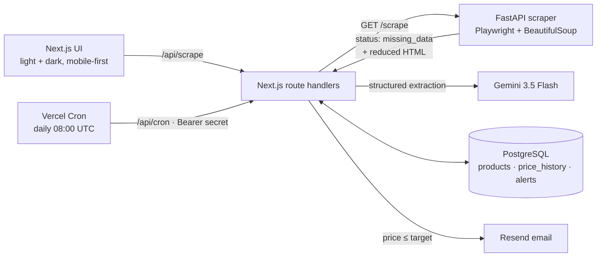

<div align="center">

# KAIROS

**A price tracker for Amazon, built like a real product.**
Paste an Amazon link, set a target price, and Kairos watches the market for you — scraping with a stealth headless browser, falling back to an LLM when the DOM fights back, and emailing you the moment your price hits.

*Kairos (καιρός) — the Greek word for the opportune moment.*


</div>

<!-- TODO: add docs/demo.gif — scan → AI fallback → arm alert -->

---

## What it does

| | |
|---|---|
| **Scan** | Paste any Amazon product URL. A headless Chromium loads the page with a randomized fingerprint and extracts name, price, stock and image. |
| **Self-heal** | Amazon changes its markup constantly. When CSS selectors miss, Kairos strips the page down to the product block and asks Gemini to extract structured JSON instead. A badge on the product card tells you which path was taken. |
| **Arm** | Set a target price and an email. Kairos stores the product, starts a price history and schedules surveillance. |
| **Alert** | A daily cron re-scrapes every watched product, records price changes, and sends one email per alert when the price drops to target — no spam on every tick. |

## Architecture



**Two services, one contract.** The Python scraper only does what Python is best at — driving a browser and parsing HTML. It returns a status (`ok`, `missing_data`, `captcha`). The Next.js layer owns everything else: validation, the AI fallback, persistence, scheduling and notifications.

## Engineering notes

A few decisions worth reading if you're reviewing the code:

- **The AI fallback sees the right HTML.** An Amazon page is over 1 MB, mostly `<head>` and inline scripts. Sending the first N characters to an LLM gives it nothing useful. The scraper removes scripts, styles and SVGs and keeps only the product container (`#dp-container` / `#ppd`) before handing off — see `reduce_html_for_ai` in [`scraper/scraper.py`](scraper/scraper.py).
- **LLM availability is not assumed.** Gemini models get overloaded (`503`) and retired regularly — both happened while building this. Extraction runs on `gemini-3.5-flash` with minimal thinking (~1 s), then falls back to `gemini-3.5-flash-lite` on overload, quota or a 15 s timeout.
- **The LLM output is untrusted.** Gemini runs in JSON mode at `temperature: 0`, and every field is type-checked before use. A hallucinated `"price": "99"` becomes `null`, not a bad alert — see [`src/lib/ai.ts`](src/lib/ai.ts).
- **Locale-aware price parsing.** `1 299,99 €`, `$1,299.99` and `1.299,00 €` all parse to the right number. The parser prefers `.a-offscreen`, which holds the full price; `.a-price-whole` drops the cents.
- **Allowlisted hosts on both sides.** The scraper only navigates to known Amazon domains, parsed by hostname rather than substring-matched, so `evil.com/?amazon` and `amazon.fr.evil.com` are rejected. Next.js checks the same list before forwarding.
- **Idempotent alerts.** One alert per `(user, product)`. Re-arming updates the target and resets `notified_at`, and a fired alert stays silent until it's re-armed.
- **A cron that survives failure.** Products are grouped so each URL is scraped once per run. Every product and every email has its own error boundary, so one CAPTCHA doesn't abort the whole run. The run returns a `{ products, updated, notified, failed }` summary.
- **Fail loudly, not emptily.** A dead ASIN returns `404 Produit introuvable`, a CAPTCHA `503`, and a page where neither the parser nor the LLM finds a price `422` — never a blank product card.
- **A chart you can read.** Hand-rolled SVG, no chart library: rounded axis ticks, crosshair + tooltip on hover, arrow-key navigation, and a screen-reader data table. Light and dark themes follow the OS.
- **Honest UI.** The price chart reads real `price_history`. A freshly scanned product has no history yet, so the chart shows a demo curve explicitly labelled `SIMULATED`.

## Run it locally

**Requirements:** Node 22+, Python 3.12+, PostgreSQL.

```bash
# 1. Web app
npm install
cp .env.example .env.local        # fill in the values
npm run db:init                   # creates / migrates the schema

# 2. Scraper
cd scraper
python -m venv venv && source venv/bin/activate
pip install -r requirements.txt
playwright install chromium
uvicorn main:app --port 8000

# 3. Back in the root
npm run dev                       # http://localhost:3000
```

Trigger a surveillance run manually:

```bash
curl -H "Authorization: Bearer $CRON_SECRET" http://localhost:3000/api/cron
```

## Environment

| Variable | Purpose |
|---|---|
| `DATABASE_URL` | Postgres connection string |
| `PYTHON_SCRAPER_URL` | Where the FastAPI scraper listens |
| `GEMINI_API_KEY` | AI fallback (optional — without it, the DOM parser result is returned as-is) |
| `GEMINI_MODEL` | Primary model (default `gemini-3.5-flash`) |
| `GEMINI_BACKUP_MODEL` | Used when the primary is overloaded (default `gemini-3.5-flash-lite`) |
| `RESEND_API_KEY` | Alert emails |
| `MAIL_FROM` | Sender (default `Kairos <onboarding@resend.dev>`) |
| `CRON_SECRET` | Shared secret for `/api/cron` |

## Tests

```bash
npm test          # Vitest — validation, scheduler logic, LLM output sanitizing, HTML escaping
npm run test:py   # pytest — price parsing, host allowlist, DOM parser, HTML reduction
```

## Deploy

- **Web:** Vercel. `vercel.json` registers the daily cron. Vercel sends `Authorization: Bearer $CRON_SECRET` automatically.
- **Scraper:** any small VPS or container host that can run Chromium (Fly.io, Railway, a $5 droplet). Expose `:8000` to the web app only.
- **Database:** Neon or Supabase free tier.

> Vercel's Hobby plan allows one cron run per day. For tighter surveillance, call `/api/cron` from the scraper host's crontab instead.

## Project layout

```
src/
  app/
    page.tsx              landing + dashboard
    api/scrape            scan a product (scraper → AI fallback)
    api/alerts            arm surveillance (validated, transactional)
    api/history           real price history for the chart
    api/cron              surveillance run (secret-protected)
    api/health            scraper status shown in the header
  components/             product card, alert form, interactive price chart, activity log
  lib/
    scrape.ts             scraper client + AI fallback orchestration
    ai.ts                 Gemini structured extraction
    scheduler.ts          cron logic
    validation.ts         input + URL allowlist
    mailer.ts             Resend
scraper/
  scraper.py              FastAPI + Playwright + parser
  test_scraper.py
db/schema.sql             idempotent schema + migrations
```

## Scope

Kairos is a portfolio project. It supports Amazon product pages and is built to demo end to end, not to run at scale. Natural next steps would be multi-retailer parsers, proxy rotation, and a queue in front of the scraper.
